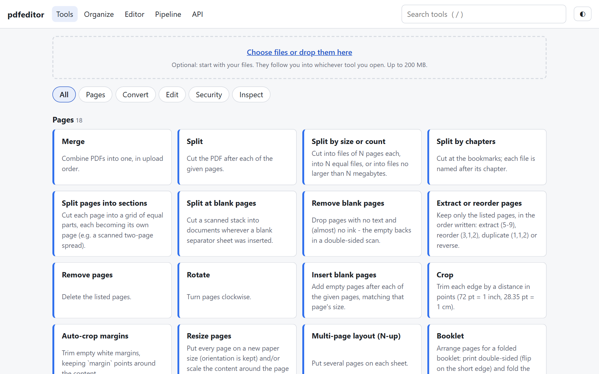
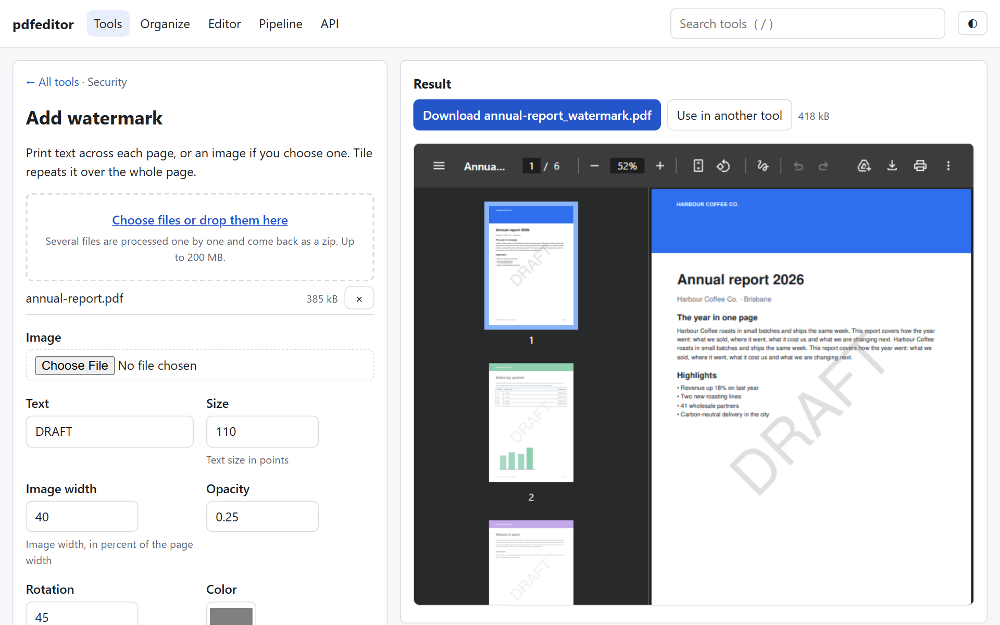
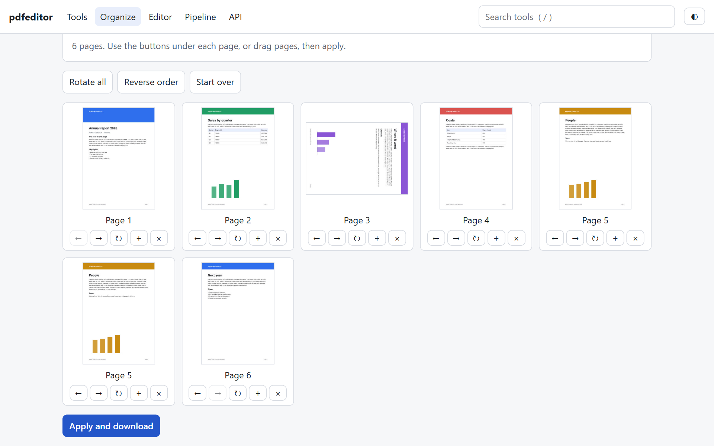
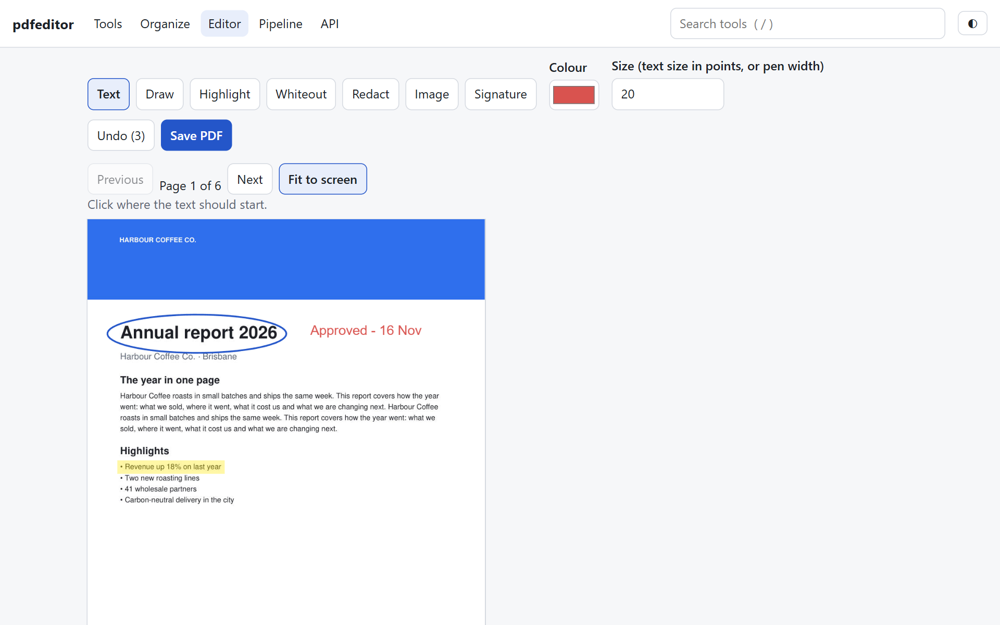
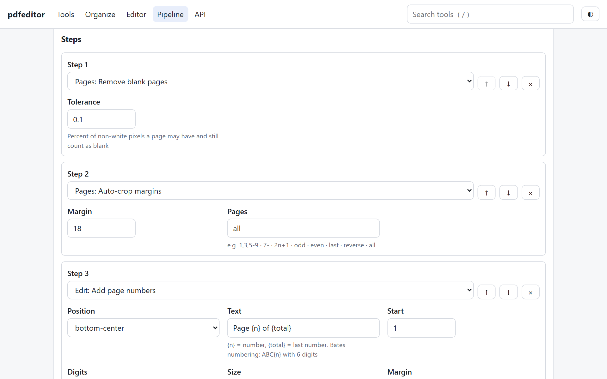
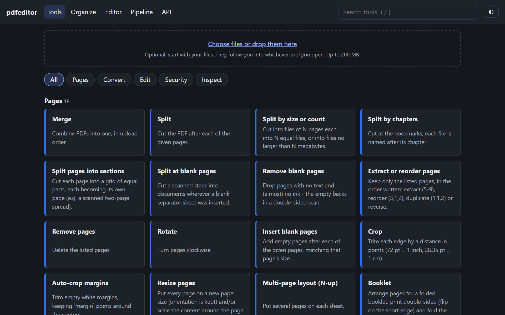
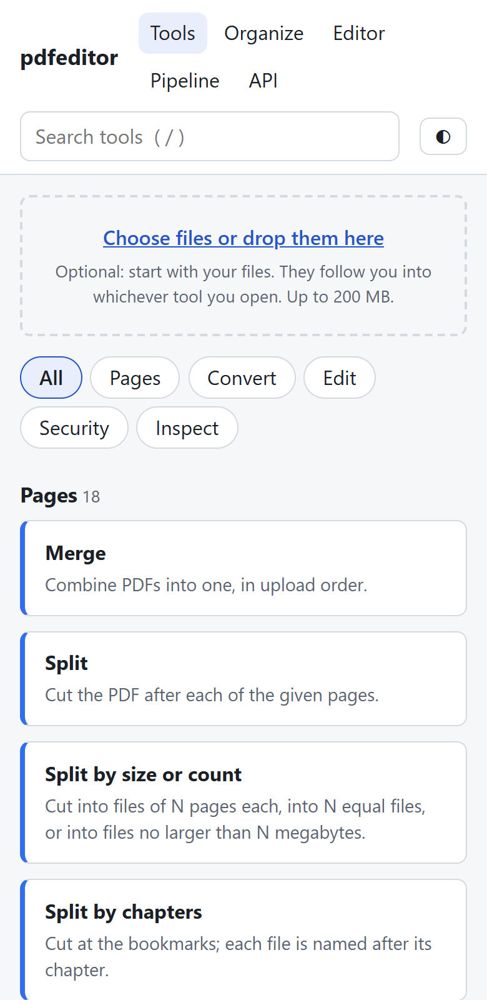
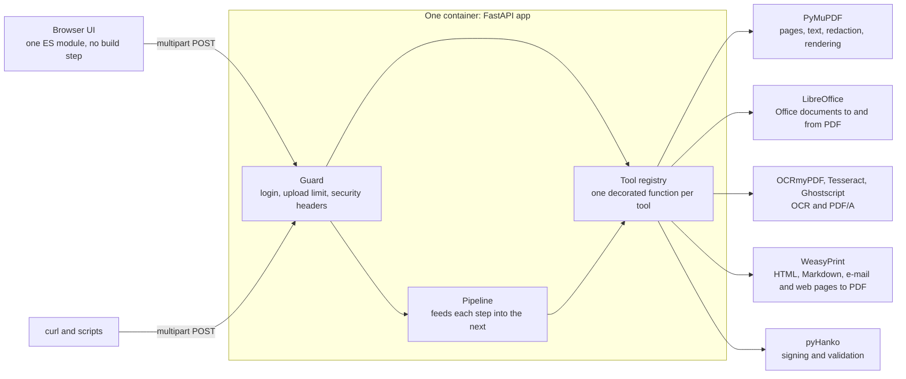

<h1 align="center">pdfeditor</h1>

<p align="center">
  <b>A self-hosted PDF toolkit: 59 tools behind one web page and one HTTP API.</b><br>
  Merge, split, convert, OCR, edit, sign, redact and compress, on your own machine.<br>
  Nothing is stored on the server: no database, no upload folder. Each request is processed on its own and its
  files are not saved.
</p>

<p align="center">
  <a href="https://github.com/kiansaeidnia/pdfeditor/actions/workflows/ci.yml"></a>
  
  
  
  
  
</p>

<p align="center">
  <a href="#quick-start">Quick start</a> ·
  <a href="#screenshots">Screenshots</a> ·
  <a href="#the-tools">The tools</a> ·
  <a href="#http-api">HTTP API</a> ·
  <a href="#configuration">Configuration</a> ·
  <a href="#security-notes">Security</a> ·
  <a href="#development">Development</a>
</p>

<p align="center">
  <picture>
    <source media="(prefers-color-scheme: dark)" srcset="docs/screenshots/home-dark.png">
    
  </picture>
</p>

## Highlights

| | |
|---|---|
| 🧰 **59 tools, 5 categories** | Pages, Convert, Edit, Security and Inspect. Every tool is a form in the browser and an endpoint in the API. |
| 🗂️ **Page organizer** | See every page as a thumbnail. Drag, rotate, duplicate and delete, then download the result. |
| ✍️ **Editor** | Type, draw, highlight, white out and redact right on the page. Place images and a hand-drawn signature. |
| ⛓️ **Pipelines** | Chain tools so each step's output feeds the next, in the browser or with one API call. |
| 📎 **Files follow you** | Drop files once on the home page; they come along into whichever tool you open. A result can go straight into the next tool. |
| 👀 **Results beside the form** | PDFs, images, text, JSON and HTML are previewed next to the form, with a download button. |
| 📦 **Batches** | Give a one-file tool several files and get a zip back. Almost every tool accepts password-protected PDFs. |
| ✉️ **E-mail a result** | Optional: send any result as an attachment through your own mail server. |
| 🌗 **Light and dark** | Follows your system, or pick one with the button in the header. Works on a phone. |
| 🐳 **One command to run** | `docker compose up -d --build`. LibreOffice, Tesseract and Ghostscript are inside the image. |

## Screenshots

<table>
  <tr>
    <td width="50%" valign="top">
      
      <p align="center"><b>Every tool</b><br><sub>Settings on the left, the result on the right.</sub></p>
    </td>
    <td width="50%" valign="top">
      
      <p align="center"><b>Page organizer</b><br><sub>Reorder, rotate, duplicate and delete pages.</sub></p>
    </td>
  </tr>
  <tr>
    <td width="50%" valign="top">
      
      <p align="center"><b>Editor</b><br><sub>Text, pen, highlighter, whiteout, redaction, images, signature.</sub></p>
    </td>
    <td width="50%" valign="top">
      
      <p align="center"><b>Pipeline builder</b><br><sub>Run several tools in a row on the same files.</sub></p>
    </td>
  </tr>
  <tr>
    <td width="50%" valign="top">
      
      <p align="center"><b>Dark theme</b><br><sub>System, light or dark.</sub></p>
    </td>
    <td width="50%" valign="top" align="center">
      
      <p align="center"><b>On a phone</b><br><sub>The same page, one column.</sub></p>
    </td>
  </tr>
</table>

## Quick start

```bash
git clone https://github.com/kiansaeidnia/pdfeditor.git
cd pdfeditor
docker compose up -d --build
```

Open <http://localhost:8080>. The first build downloads LibreOffice and takes a few minutes; the image is about 1.2 GB.

> [!IMPORTANT]
> Out of the box the app only answers on the machine it runs on, and it has **no login**. To reach it from other
> devices, set `AUTH_PASSWORD` **and** `BIND=0.0.0.0` in a `.env` file (copy `.env.example`), then run
> `docker compose up -d` again. See [Security notes](#security-notes) before exposing it.

### Ready-made image

Every commit on `main` that passes CI is published to the registry at `registry.saeidnia.com` as
`pdfeditor:latest` and `pdfeditor:<short commit hash>`. A git tag such as `v1.2.0` is published under its own name.
Pull requests never publish.

```bash
docker pull registry.saeidnia.com/pdfeditor:latest
```

The registry has no login: anyone who knows the address can pull, push and delete.

The registry sits behind a Cloudflare Tunnel, which refuses any single upload over 100 MB, so CI uploads the
image in 50 MB chunks with [regctl](https://github.com/regclient/regclient) instead of `docker push`. Pulling is
unaffected.

## The tools

Open a category to see what is in it. The **API id** is the last part of the tool's address: `POST /api/tools/<id>`.

<details>
<summary><b>📄 Pages</b> &nbsp;·&nbsp; 18 tools</summary>

| Tool | API id | What it does |
|---|---|---|
| **Merge** | `merge` | Combine PDFs into one, in upload order. |
| **Split** | `split` | Cut the PDF after each of the given pages. |
| **Split by size or count** | `split-by` | Cut into files of N pages each, into N equal files, or into files no larger than N megabytes. |
| **Split by chapters** | `split-chapters` | Cut at the bookmarks; each file is named after its chapter. |
| **Split pages into sections** | `split-sections` | Cut each page into a grid of equal parts, each becoming its own page (e.g. a scanned two-page spread). |
| **Split at blank pages** | `split-blank` | Cut a scanned stack into documents wherever a blank separator sheet was inserted. |
| **Remove blank pages** | `remove-blank` | Drop pages with no text and (almost) no ink - the empty backs in a double-sided scan. |
| **Extract or reorder pages** | `organize` | Keep only the listed pages, in the order written: extract (5-9), reorder (3,1,2), duplicate (1,1,2) or reverse. |
| **Remove pages** | `remove-pages` | Delete the listed pages. |
| **Rotate** | `rotate` | Turn pages clockwise. |
| **Insert blank pages** | `insert-blank` | Add empty pages after each of the given pages, matching that page's size. |
| **Crop** | `crop` | Trim each edge by a distance in points (72 pt = 1 inch, 28.35 pt = 1 cm). |
| **Auto-crop margins** | `auto-crop` | Trim empty white margins, keeping `margin` points around the content. |
| **Resize pages** | `resize` | Put every page on a new paper size (orientation is kept) and/or scale the content around the page centre. |
| **Multi-page layout (N-up)** | `n-up` | Put several pages on each sheet. |
| **Booklet** | `booklet` | Arrange pages for a folded booklet: print double-sided (flip on the short edge) and fold the stack in half. |
| **Single long page** | `single-page` | Stack all pages into one tall page. |
| **Overlay** | `overlay` | Draw the pages of a second PDF over (or under) this one, e.g. a letterhead. |

</details>

<details>
<summary><b>🔄 Convert</b> &nbsp;·&nbsp; 9 tools</summary>

| Tool | API id | What it does |
|---|---|---|
| **Convert to PDF** | `to-pdf` | Turn images, Office documents (Word, Excel, PowerPoint, OpenDocument), HTML, Markdown, text, e-mail (.eml), EPUB, SVG or comics (.cbz) into PDF. |
| **Web page to PDF** | `url-to-pdf` | Save a web page as PDF. |
| **PDF to images** | `pdf-to-images` | Save pages as pictures (a zip when there is more than one). |
| **PDF to text, Markdown, HTML or XML** | `pdf-to-text` | Extract the text. |
| **PDF tables to CSV** | `pdf-to-csv` | Find tables and save each one as a CSV file. |
| **PDF to Word, PowerPoint or OpenDocument** | `pdf-to-office` | Convert with LibreOffice. |
| **OCR (make scans searchable)** | `ocr` | Recognise the text on scanned pages and add it as an invisible, searchable layer. |
| **PDF to PDF/A** | `pdf-to-pdfa` | Convert to PDF/A, the self-contained format for long-term archiving. |
| **Convert to image PDF** | `rasterize` | Replace every page with a picture of itself: nothing can be selected, copied or recovered afterwards. |

</details>

<details>
<summary><b>✏️ Edit</b> &nbsp;·&nbsp; 17 tools</summary>

| Tool | API id | What it does |
|---|---|---|
| **Add stamp** | `stamp` | Place text or an image - a logo, a scanned signature, a header or footer - at a fixed spot on each page. |
| **Add page numbers** | `page-numbers` | Number the selected pages in order, including Bates numbering. |
| **Find and replace text** | `replace-text` | Swap every occurrence of a phrase (ignoring case). |
| **Highlight text** | `highlight` | Mark every occurrence of the given text with a highlighter annotation. |
| **Edit metadata** | `metadata` | Set the document properties. |
| **Edit bookmarks** | `bookmarks` | Replace the table of contents shown in the reader's sidebar. |
| **Fill form** | `fill-form` | Fill in form fields. |
| **Unlock form fields** | `unlock-forms` | Make read-only form fields editable again. |
| **Flatten** | `flatten` | Burn form fields and annotations into the page so they can no longer be edited. |
| **Add attachments** | `attach` | Embed files inside the PDF. |
| **Extract attachments** | `extract-attachments` | Save the files embedded in the PDF. |
| **Remove annotations** | `remove-annotations` | Delete comments, highlights and other mark-up, and optionally links. |
| **Remove images** | `remove-images` | Blank out the pictures on the selected pages, leaving text and drawings. |
| **Adjust colours** | `adjust-colors` | Change brightness, contrast and saturation. |
| **Invert colours** | `invert-colors` | Turn pages into their negative, for reading in the dark. |
| **Grayscale** | `grayscale` | Convert all colours to gray. |
| **Scanner effect** | `scan-effect` | Make a PDF look printed and scanned: slightly tilted, soft and grainy. |

</details>

<details>
<summary><b>🔒 Security</b> &nbsp;·&nbsp; 8 tools</summary>

| Tool | API id | What it does |
|---|---|---|
| **Add password** | `protect` | Encrypt with AES-256, with a password to open the file and optional limits on printing, copying and editing. |
| **Remove password** | `unlock` | Save a copy with no password and no restrictions. |
| **Sanitize** | `sanitize` | Strip active and hidden content before sharing a file. |
| **Redact text** | `redact` | Permanently remove every occurrence of the given text - and any image pixels under it - and cover the spot with a box. |
| **Add watermark** | `watermark` | Print text across each page, or an image if you choose one. |
| **Sign with certificate** | `sign` | Add a digital signature from a PKCS#12 certificate (.p12 or .pfx). |
| **Validate signatures** | `validate-signatures` | Check each digital signature: who signed, whether the file changed since, and whether the certificate chains to an authority this server trusts. |
| **Remove signatures** | `remove-signatures` | Delete digital signature fields. |

</details>

<details>
<summary><b>🔍 Inspect</b> &nbsp;·&nbsp; 7 tools</summary>

| Tool | API id | What it does |
|---|---|---|
| **Info** | `info` | Everything about the document as JSON: properties, permissions, bookmarks, form fields, attachments, fonts, scripts and per-page details. |
| **Show JavaScript** | `javascript` | List the scripts embedded in the PDF. |
| **Compare** | `compare` | Side-by-side report of the text differences between two PDFs. |
| **Compress** | `compress` | Shrink the file: downsample and recompress pictures, embed only the used characters of each font, and drop unused data. |
| **Repair** | `repair` | Rebuild a damaged file. |
| **Extract images** | `extract-images` | Save the pictures embedded in the PDF, in their original format. |
| **Auto-rename** | `auto-rename` | Name the file after its title: the largest text on the first page. |

</details>

Tools that work on one PDF at a time also take several files at once; the result is then a zip. Merge, Compare and
Convert to PDF combine their files into one result instead.

Every tool that opens a PDF accepts a password-protected one (give the password with the request), except Sign with
certificate, Validate signatures and Convert to PDF: use Remove password on the file first. In a pipeline the
password is used for the first step only. Results are always saved **without** a password; add one back with
"Add password".

### Page selections

Wherever a tool asks for pages:

| You write | You get |
|---|---|
| `1,3,5-9` | pages 1, 3 and 5 to 9 |
| `7-` | page 7 to the end |
| `last` | the last page |
| `odd` · `even` | every odd or every even page |
| `2n+1` | every second page from 1 |
| `reverse` | all pages, last first |
| `all` | every page |

Where the pages you list become the result (Extract or reorder, PDF to images, PDF to text, PDF tables to CSV),
order and repeats are kept, so `3,1,1` means page 3, then page 1 twice. Tools that change pages in place (Rotate,
Crop, Add page numbers, Add watermark and so on) only look at which pages are listed.

### In the browser

- **Search** from anywhere with <kbd>/</kbd>; <kbd>Esc</kbd> clears it. The home page also remembers the tools you used last.
- **Page organizer:** move pages by dragging or with the arrow buttons, rotate, duplicate, delete, or use
  "Rotate all" and "Reverse order". Nothing changes until you press "Apply and download".
- **Editor:** pick a mode (Text, Draw, Highlight, Whiteout, Redact, Image, Signature), then click or drag on the
  page. <kbd>Ctrl</kbd>+<kbd>Z</kbd> undoes the last edit. Redaction removes what is under the box for good.
- **Pipeline builder:** add steps, set each one's options, reorder them. The plan is shown as JSON you can copy,
  paste back later, or send to the API as it is.

## HTTP API

Interactive documentation for every tool is at `/api/docs`. `GET /api/tools` lists the tools and their settings as
JSON, plus two internal helpers (`edit` and `preview`) that the editor and the page organizer use.

```bash
# one tool: rotate pages 1-3 by 90 degrees
curl -F files=@in.pdf -F angle=90 -F pages=1-3 -o out.pdf http://localhost:8080/api/tools/rotate

# several files at once: the answer is a zip
curl -F files=@a.pdf -F files=@b.pdf -o rotated.zip http://localhost:8080/api/tools/rotate

# a password-protected PDF: give its password with the request
curl -F files=@locked.pdf -F password=secret -o open.pdf http://localhost:8080/api/tools/unlock

# Info answers in JSON (so do Show JavaScript and Validate signatures)
curl -F files=@in.pdf http://localhost:8080/api/tools/info

# a pipeline: each step's output feeds the next
curl -F files=@scan.pdf -o out.pdf http://localhost:8080/api/pipeline \
  -F 'steps=[{"tool": "remove-blank"}, {"tool": "ocr"}, {"tool": "compress", "params": {"level": "high"}}]'
```

With a login set, add `-u admin:yourpassword`. Errors come back as JSON: `{"detail": "what went wrong"}`. A setting
with an invalid value is HTTP 422, where `detail` is a list naming each bad field; a missing or wrong login is a
bare 401 with no body.

A pipeline takes up to 30 steps. Tools that take a second upload, even an optional one, can't be a step: `overlay`,
`stamp`, `watermark`, `attach` and `sign`.

## How it works



A tool is one decorated function in `app/tools/`. Its signature is its schema, so the API endpoint, the API docs
and the web form all come from it. This is the whole Rotate tool:

```python
@tool("Rotate", "Pages")
def rotate(doc: PDF, angle: Literal["90", "180", "270"] = "90", pages: Pages = "all"):
    """Turn pages clockwise."""
    for i in set(parse_pages(pages, len(doc))):
        doc[i].set_rotation(doc[i].rotation + int(angle))
    return doc
```

The web page is plain HTML, CSS and one JavaScript module, and loads nothing from other sites. Only the
interactive API docs at `/api/docs` fetch their viewer from a CDN.

## Configuration

Set these in a `.env` file next to `docker-compose.yml` (copy `.env.example`).

| Variable | Default | Meaning |
|---|---|---|
| `BIND` | `127.0.0.1` | Address the app is published on. The default is this machine only; `0.0.0.0` opens it to the network. |
| `PORT` | `8080` | Port it is published on. |
| `AUTH_USER` | `admin` | Login name. |
| `AUTH_PASSWORD` | empty | Login password. **Empty means no login at all.** |
| `MAX_UPLOAD_MB` | `200` | Largest accepted request. |
| `CONVERT_TIMEOUT` | `300` | Seconds LibreOffice or OCR may spend on one file. |
| `WORKERS` | `2` | Server processes. Each handles one PDF job at a time. |
| `APP_NAME` | `pdfeditor` | Title shown in the UI and the API docs. |
| `OCR_LANGS` | `eng` | Tesseract languages built into the image, e.g. `eng deu fra` (build-time). |
| `SMTP_HOST`, `SMTP_PORT`, `SMTP_USER`, `SMTP_PASSWORD`, `SMTP_FROM` | empty, `587` | Lets users e-mail a result. See below. |

### E-mailing results

Set `SMTP_HOST` and a sender (`SMTP_FROM`, or `SMTP_USER` if they are the same) **and** `AUTH_PASSWORD`. Every
result then gets an "E-mail this file to" field. E-mail stays off without a login password, so that nobody who
merely reaches the app can send mail from your domain.

- Port 465 uses TLS from the start, any other port STARTTLS; a server without TLS is refused.
- One recipient per message, and attachments up to 20 MB.

## Security notes

> [!WARNING]
> There is **no login until you set `AUTH_PASSWORD`**. Set it, and put the app behind HTTPS, before exposing it
> beyond a network you trust. The login is HTTP Basic, which is only safe over HTTPS.

- "Web page to PDF" and HTML conversion only fetch from public internet addresses and never run JavaScript. The
  address check and the download resolve the name separately, so a hostile DNS server could still redirect one to an
  internal address; do not offer this tool to untrusted users on a network with sensitive internal services.
- Uploaded Office documents are opened by LibreOffice, and PDFs by MuPDF. Keep the image up to date.
- Redaction removes the text and the image pixels under it, not just covers them. Regular expressions in the redact
  and highlight tools run without a time limit.
- The container runs as an unprivileged user, and the web page is served with a strict Content-Security-Policy.

## Limits

- One shared login; no user accounts, roles or single sign-on.
- English interface only.
- Certificate signing takes PKCS#12 (`.p12`/`.pfx`) files only.
- Scanned stacks are split at blank separator sheets, not QR-code sheets.
- Each worker runs one PDF job at a time; raise `WORKERS` for more.
- The page organizer opens PDFs of up to 500 pages.

## Development

```bash
python -m venv .venv
.venv/Scripts/python -m pip install -r requirements-dev.txt   # Linux/macOS: .venv/bin/python
.venv/Scripts/python -m pytest -q
.venv/Scripts/python -m uvicorn app.main:app --port 8080      # the app, without Docker
```

Tests that need LibreOffice, Tesseract, Ghostscript or WeasyPrint are skipped when those are missing. CI runs the
whole suite inside the Docker image with `REQUIRE_ALL=1`, where a missing program is a failure instead of a skip,
and then smoke-tests the running container over HTTP:

```bash
docker build -t pdfeditor:dev .
docker run --rm -e REQUIRE_ALL=1 -v "$PWD/tests:/srv/tests:ro" -v "$PWD/pyproject.toml:/srv/pyproject.toml:ro" \
  -v "$PWD/requirements-dev.txt:/srv/requirements-dev.txt:ro" pdfeditor:dev \
  sh -c "pip install -q --user -r requirements-dev.txt && python -m pytest -q"
```

On Windows run that in WSL, or in Git Bash put `MSYS_NO_PATHCONV=1` in front of `docker run`: otherwise Git Bash
rewrites the `/srv/...` paths and nothing is mounted.

```text
app/
  core.py        the tool registry, page selections and shared drawing helpers
  main.py        the FastAPI app: one endpoint per tool, the pipeline, login, e-mail
  tools/         the tools themselves: pages, convert, edit, security, other
  static/        the web page: index.html, style.css, app.js
tests/           more than 200 tests: every tool, the HTTP layer, page geometry
Dockerfile, docker-compose.yml, .github/workflows/ci.yml
```

## Licence of the parts

The PDF engine (PyMuPDF) and Ghostscript are AGPL-licensed. Using this privately is unrestricted; if you let other
people use your instance over a network, the AGPL requires you to offer them this source code.
